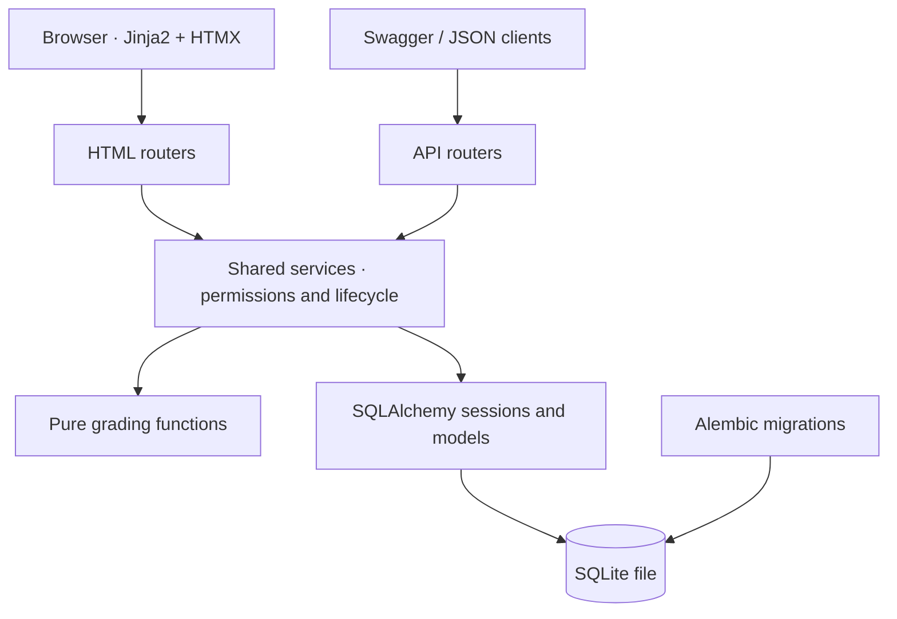

# Quizzer — teach, practice, and see your progress

Architecture milestones 1–9 are implemented: accounts, questions, assigned and
practice quizzes, a Jinja2/HTMX browser interface, teacher analytics, Alembic
migrations, and Docker packaging. See
[ARCHITECTURE.md](ARCHITECTURE.md) for the design.
See [IMPLEMENTATION_PLAN.md](IMPLEMENTATION_PLAN.md) for architecture gaps,
behavior decisions, and the remaining plan.

## Run on Windows

From this folder in PowerShell, using Python 3.11+ and `uv`:

```powershell
uv venv .venv --python python
uv pip install --python .venv\Scripts\python.exe -r requirements-dev.txt
# First run: generate a signing key for this terminal (or configure an ignored .env).
$env:SECRET_KEY = & .venv\Scripts\python.exe -c "import secrets; print(secrets.token_hex(32))"
.venv\Scripts\python.exe -m scripts.migrate
.venv\Scripts\python.exe -m scripts.seed
.venv\Scripts\python.exe -m uvicorn app.main:app --reload --host 127.0.0.1
```

For a machine without `uv`, create the environment with `python -m venv .venv`
and install with `.venv\Scripts\python.exe -m pip install -r requirements-dev.txt`;
the remaining commands are the same. No environment activation is required.
For runtime dependencies alone, install `requirements.txt` instead.

Open [Quizzer](http://127.0.0.1:8000/) and sign in. Seeded accounts are
`teacher@example.test`, `alice@example.test`, and `bob@example.test`, all with
password `quiz-demo-password`. For an existing checkout, install the updated
requirements and run the migration command; your existing ignored `.env` can keep
providing the signing key instead of generating a new one.

You can also open [the API docs](http://127.0.0.1:8000/docs), expand `GET /health`, and click
**Try it out → Execute**. Or open [the health endpoint](http://127.0.0.1:8000/health)
directly; expect `{"status":"ok","milestone":"authentication"}`.
Stop the server with Ctrl+C.

The browser pages and JSON API call the same services. The health endpoint verifies database
connectivity; it does not expose seeded accounts, questions, or answers.

## Use the browser interface

- **Teacher:** Overview → My questions → Add a question. The editor switches
  between multiple choice, true/false, and short answers. Mark a question public
  to share it in the bank. My quizzes → Build a quiz lets you select your own or
  shared questions, change their points, save a draft, publish, and select students.
  Published quiz pages link to student results and analytics.
- **Student:** Overview and Assignments show assigned quizzes. Start or resume,
  submit your answers, then review your score and explanations. My progress lists
  prior/open attempts by quiz title. Question bank lets you search/filter, select
  questions across pages, and create unlimited practice quizzes.

All lists have pagination. HTMX refreshes the bank and builder question lists;
selections stay in the current page while those lists change. JavaScript enables
adaptive editor fields and selection controls. All assets, including pinned HTMX
2.0.8 and its license, are local; there is no frontend build step or CDN dependency.

HTML mutations use signed, account-bound double-submit CSRF tokens. Login rotates
the binding; expired forms ask you to reload. Private pages/partials use no-store
headers, and the server supplies safe DTOs to in-progress student templates.
HTML errors remain readable; expired sessions redirect to sign-in.

## Architecture



## Analytics

Teachers can open **Results & insights** on their own published quizzes or call
`GET /api/quizzes/{quiz_id}/analytics`. Analytics report total/submitted/open
attempts, average/min/max percentage, per-question accuracy, and five score bins:
`[0,20)`, `[20,40)`, `[40,60)`, `[60,80)`, `[80,100]` percent. Only submitted
attempts contribute to grades and accuracy. Missing responses are incorrect.
With no submitted data, averages and accuracies are null (shown as `—`), and all
bucket counts are zero. Source-question edits/deletion do not change these results.

## Database migrations

```powershell
.venv\Scripts\python.exe -m scripts.migrate
```

For a new database, this applies the explicit Alembic baseline. For an existing
milestone 1–7 SQLite database, it compares the schema with the models, creates a
consistent `*.pre-alembic-<timestamp>.db` backup, stamps baseline `0001`, and applies
later revisions. It refuses an unrelated/different untracked schema instead of
resetting it. Repeated runs are safe. Domain tables/data are unchanged; Alembic
adds its `alembic_version` bookkeeping table. Backups remain ignored by Git and
excluded from Docker images.

When changing models later, create and review a revision with
`.venv\Scripts\alembic.exe revision --autogenerate -m "Describe the change"`, then
run `scripts.migrate` again. Startup `create_all` still supports demo/test
bootstrapping; it does not alter existing columns and does not replace migrations.

## Run with Docker

Set a persistent random `SECRET_KEY` (at least 32 bytes) in the ignored `.env`
file before running Compose. `.env.example` shows the available settings.

```powershell
docker compose up --build -d
docker compose exec web python -m scripts.seed
```

Open [Quizzer](http://127.0.0.1:8000/). Compose binds to local loopback, runs the app
as a non-root user, performs migrations before Uvicorn starts, and stores SQLite
in the named `quiz_data` volume at `/data/quizapp.db`. A health check tests database
connectivity. No secret, development environment, or local database is copied
into the image. Seeding is explicit, so new installations can instead register
their own accounts. `docker compose down` stops the app and keeps its volume.

The Docker database is separate from the local `quizapp.db`. Keep the signing key
stable to preserve sessions across restarts. For HTTPS hosting set
`COOKIE_SECURE=true`. Login rate limiting and additional JSON API CSRF hardening
remain future deployment work; teacher registration is still self-selected.

## Try the complete workflow

With the server running and the seed loaded, open another terminal in this folder:

```powershell
.venv\Scripts\python.exe -m scripts.demo_workflow
```

The demo logs in as the seeded teacher and Bob, creates three questions and a
weighted quiz, publishes/assigns it, then edits a source question. Bob resumes,
submits, and reviews the assigned quiz for **10/10**, showing that its snapshot
keeps the original answer. It then creates a practice quiz from the updated public
bank and grades **2/2**. The demo checks safe student responses, attempt limits,
duplicate-submission rejection, teacher results, and logout.

Each run adds fresh demo questions, quizzes, and attempts. It does not reset
existing data. Use `--base-url http://127.0.0.1:8765` for a different server port,
or `--json` for the created ids and scores.

## Try quizzes manually in Swagger

1. Log in as `teacher@example.test` / `quiz-demo-password`. Use `GET /api/questions`
   and `GET /api/students` to find source question ids and Bob's student id.
2. Create a draft with `POST /api/quizzes` (replace the example ids):

   ```json
   {
     "title": "Math check",
     "questions": [{"question_id": 1, "points": 2}, {"question_id": 2, "points": 3}],
     "max_attempts": 1,
     "due_at": null
   }
   ```

3. Use the returned quiz id with `POST /api/quizzes/{quiz_id}/publish`, then
   `/api/quizzes/{quiz_id}/assignments` with `{"student_ids": [3]}` (use Bob's
   actual id). Assignments are idempotent and may be extended later.
4. Log in as `bob@example.test` with the same demo password. Clear Swagger
   **Authorize** if a bearer token was set. `GET /api/quizzes/assigned` lists Bob's
   assignments; `POST /api/quizzes/{quiz_id}/attempts` starts one (201) or resumes
   the existing open attempt (200).
5. Submit with `POST /api/attempts/{attempt_id}/submit`, using the **quiz-question
   link ids from the attempt's `questions[].id`**, which differ from source ids:

   ```json
   {"answers": [{"quiz_question_id": 4, "response": "a"}, {"quiz_question_id": 5, "response": true}]}
   ```

6. `GET /api/attempts/{attempt_id}` now returns the score, response, correctness,
   points, correct answer, and explanation for each question. Before submission
   it returns safe question content. Log back in as the teacher and use
   `GET /api/quizzes/{quiz_id}/results` for scores, or `GET /api/quizzes` for drafts
   and published quizzes.

Teachers can use their own questions and other teachers' public questions.
Draft PUT replaces the whole quiz. Publishing rechecks sources and freezes the
title, deadline, limits, points, and content; later source edits/deletion cannot
change the quiz or past grades. Empty drafts are allowed but cannot be published.

Starts consume attempts; repeated starts resume one open attempt. Starts/resumes
and submissions are rejected at or after `due_at` (409); a due date must include
a timezone. Submitted reviews remain readable afterward. `max_attempts: null`
means unlimited. A duplicate submit returns 409. Omitted/null responses are wrong;
foreign/duplicate link ids, invalid choice ids, and malformed response types
return 422 without changing the attempt. Send JSON booleans for true/false and
strings for MCQ/short answers; an empty MCQ string is treated as unanswered.

## Try the question bank and practice

`GET /api/bank/questions` searches only public questions for either role. Filters
are `q` (prompt/topic), exact `topic`, and `type`, with `page` and `page_size` (1–50,
default 20). `%`/`_` are literal search characters. Response `view` is `teacher` or
`student`; student items never include `correct_answer` or `explanation`.

As Bob, select public source ids and call `POST /api/quizzes/practice`:

```json
{"title": "My practice", "question_ids": [1, 2]}
```

The response is a published, student-owned quiz with one point per question,
no deadline, and unlimited attempts. It uses the exact same start/submit/review
endpoints as assigned quizzes. It snapshots the current bank content immediately;
another student's practice quizzes are inaccessible. `GET /api/quizzes` lists
your own practice quizzes; `GET /api/quizzes/assigned` lists teacher assignments.
All quiz selections require unique ids and at most 100 questions; practice
requires at least one public question.

## Try authentication

In [the API docs](http://127.0.0.1:8000/docs):

1. Execute `GET /api/me` before logging in; it returns 401.
2. Execute `POST /api/auth/login` with:

   ```json
   {"email": "teacher@example.test", "password": "quiz-demo-password"}
   ```

3. Execute `GET /api/me` again. The browser sends the HTTP-only cookie and the
   response contains your id, name, email, role, and creation time.
4. Execute `POST /api/auth/logout` (204), then `/api/me` again (401).

To create an account, use `POST /api/auth/register`:

```json
{
  "name": "New Student",
  "email": "student@example.test",
  "password": "choose-a-long-password",
  "role": "student"
}
```

Registration returns 201 and does not log in automatically. Names are trimmed;
email addresses are trimmed, validated, and case folded before storage and login.
Passwords preserve whitespace and must be 8–128 characters at registration.
Existing normalized email addresses return 409; bad login credentials return the
same generic 401 for an unknown account and an incorrect password.

For bearer authentication, copy `access_token` from a login response, click
**Authorize**, and paste the token alone. A nonempty cookie takes precedence over
the header; an invalid cookie is rejected rather than falling back to the header.
In Swagger, clear **Authorize** before testing cookie-only logout behavior.

All private API routes are mounted through the authenticated router in
`app/main.py`. `/api/me` and `/api/auth/logout` require login. Register, login,
health, docs, ReDoc, and OpenAPI remain public.

Behavior limits: users may select `teacher` when registering, as the draft
specifies. Logout clears the cookie; it does not revoke copied bearer tokens,
which remain usable until their expiry while the original account and credentials
still exist. Resource routes enforce role, ownership, assignment, and attempt-owner
checks. HTML forms have CSRF tokens; JSON API CSRF hardening and login rate limiting
remain future deployment work.

## Try question CRUD

Log in as the demo teacher, then execute `POST /api/questions` in Swagger with:

```json
{
  "type": "mcq",
  "text": "What is the capital of France?",
  "topic": "Geography",
  "choices": [{"id": "a", "text": "Paris"}, {"id": "b", "text": "Rome"}],
  "correct_answer": "a",
  "explanation": "Paris is the capital of France.",
  "is_public": false
}
```

The response is 201 and includes the new `id`. Use that id with
`GET /api/questions/{question_id}`, `PUT /api/questions/{question_id}`, and
`DELETE /api/questions/{question_id}` (204). PUT replaces all question content;
omitting `is_public` or `explanation` resets them to false and null. Author and
creation time cannot be changed. Switching type clears obsolete choices.

`GET /api/questions` returns `{items, total, page, page_size}` for the logged-in
teacher's questions, newest first. Optional filters are `q` (prompt/topic search),
`topic` (exact match), `type`, and `is_public`. Pagination starts at page 1, defaults
to 20 items, and permits 1–50 items per page. Invalid limits return 422. Search
characters `%` and `_` are literal characters, not SQL wildcards.

For other types, replace the type-specific fields:

```json
{"type": "true_false", "text": "Two is even.", "topic": "Math", "correct_answer": true}
```

```json
{"type": "short_answer", "text": "What is 2 + 2?", "topic": "Math", "correct_answer": ["4", "four"]}
```

MCQs require 2–6 choices with unique ids and a matching answer id. True/false
requires an actual JSON boolean; short answers require at least one nonblank
accepted string. Non-MCQs have no choices. Prompts and topics must be nonblank.
Malformed content returns 422 without changing stored questions.

Anonymous requests return 401. Students receive 403 on every question CRUD route.
Another teacher's question returns 404, even when public; public-bank access is
planned for architecture milestone 7. Editing or deleting source questions keeps
the existing published snapshots and grades intact.

## Try the grading engine

From `.venv\Scripts\python.exe`:

```python
from app.services.grading import grade

grade({"type": "short_answer", "correct_answer": ["Paris"]}, "  PARIS  ")  # True
grade({"type": "true_false", "correct_answer": True}, 1)  # False
grade({"type": "mcq", "correct_answer": "a"}, "a")  # True
```

`grade(snapshot, response)` is a pure function, with no database or HTTP access.
MCQ ids match exactly. True/false never coerces integers or strings. Short answers
ignore case and repeated whitespace, and accept any configured alias. Empty,
missing (`None`), and wrong-type responses are incorrect. Unsupported question
types raise `ValueError`. The attempt service uses this engine for weighted,
all-or-nothing points per question.

## Inspect the database

The default database is `quizapp.db` in the current working directory. Run the
seed command again to see unchanged table counts. Its initial fixture contains:

| Table | Rows |
| --- | ---: |
| users | 3 |
| questions | 3 |
| quizzes | 1 |
| quiz_questions | 3 |
| quiz_assignments | 2 |
| attempts | 1 |
| answers | 3 |

The teacher is `teacher@example.test`, with students `alice@example.test` and
`bob@example.test`. Each has the local demo password `quiz-demo-password`, stored
as an Argon2 hash. These accounts work with the login endpoint.
Alice has a fixed sample result of 2/3; Bob has not attempted the assigned quiz.

To query the ORM yourself:

```powershell
.venv\Scripts\python.exe
```

```python
from sqlalchemy import select
from app.database import SessionLocal, create_tables
from app.models import User, Quiz, Attempt

create_tables()
with SessionLocal() as db:
    print([(user.name, user.role.value) for user in db.scalars(select(User))])
    print([(quiz.title, quiz.max_attempts) for quiz in db.scalars(select(Quiz))])
    print([(attempt.score, attempt.max_score) for attempt in db.scalars(select(Attempt))])
```

## Configuration

Environment variables or an optional `.env` file configure `DATABASE_URL`,
`SECRET_KEY`, `ACCESS_TOKEN_MINUTES` (default 60), and `COOKIE_SECURE` (default
false). `.env.example` shows the format. Startup fails if the signing secret is
missing or shorter than 32 bytes. Use a random value, such as the command above;
keep it in the environment or in an ignored `.env`. A persistent key preserves
sessions across server restarts; generating a new key invalidates existing tokens.
Seeding and database shell queries still work without a signing key.

JWTs use HS256 with required subject, issue time, expiry, and account-version
claims. The version is a keyed fingerprint of the account's salted password hash;
the hash itself is never exposed. This prevents an old token from accessing a new
account if SQLite reuses a deleted user id, without changing the existing schema.
Tokens issued before this change are rejected; log in again once after updating.
Login sets
`access_token` as an HTTP-only, SameSite=Lax cookie with path `/` and a lifetime
matching the JWT. Set `COOKIE_SECURE=true` when serving over HTTPS; local HTTP
development needs false. Successful auth responses prevent caching, and validation errors
omit raw input so invalid passwords are not echoed. The implementation follows
the [FastAPI JWT example](https://fastapi.tiangolo.com/tutorial/security/oauth2-jwt/)
and [PyJWT validation documentation](https://pyjwt.readthedocs.io/en/stable/usage.html).

SQLite foreign keys are enabled on every connection, following the
[SQLAlchemy SQLite guidance](https://docs.sqlalchemy.org/en/20/dialects/sqlite.html#foreign-key-support).
Startup table creation uses FastAPI's
[lifespan mechanism](https://fastapi.tiangolo.com/advanced/events/).
`create_all` does not alter existing tables; use the migration command above for
tracked schema upgrades.

## Checks

```powershell
.venv\Scripts\python.exe -m pytest -q
.venv\Scripts\ruff.exe check app scripts tests alembic
.venv\Scripts\ruff.exe format --check app scripts tests alembic
node --check app/static/app.js
```

Tests use isolated temporary/in-memory databases and never seed the local demo
database. They exercise schema creation, every table, foreign-key enforcement,
snapshot preservation after source deletion, duplicate/cross-quiz answer rejection,
attempt-limit defaults, UTC round trips, hashed demo passwords, seed repeatability,
file persistence, environment settings, and HTTP startup/health/docs. Authentication
tests cover registration validation and duplicate-email races, cookie and bearer
login, generic failures, cookie flags, expiry, tampered/malformed tokens, deleted
users, reused account ids, logout behavior, response privacy, and missing-secret
startup failures. A contract test discovers every private API operation and checks
missing/invalid/expired credentials via both headers and cookies. Question tests
cover validation, all type changes, authorization/ownership, filtering/pagination,
safe student projections, and snapshot preservation. Grading tests cover every
type, empty/wrong-type responses, Unicode case folding, and whitespace handling.

The complete suite has **240 passing tests**. Workflow tests cover transactional
publication/assignment, eligibility and ownership, frozen snapshots, weighted
grading, deadline boundaries, unlimited practice, per-role serialization, and
rollback on answer-write failure. Separate file-backed SQLite tests race starts,
submits, and assignments. Workflow transactions acquire
[`BEGIN IMMEDIATE`](https://www.sqlite.org/lang_transaction.html) before reading
mutable state; PostgreSQL concurrency is not yet verified.

Web tests submit rendered HTML forms, check CSRF/session handling and escaping,
exercise all editors/build/assign/take/review/practice pages, and verify HTMX
partials contain no answer keys. Analytics tests cover empty data, weights,
bucket boundaries, permissions, and frozen content. Migration tests cover new,
existing, mismatched, and repeated initialization paths. A real Docker run verified
the API demo, HTML workflows, static assets, analytics, non-root execution, health,
and persisted data/sessions after container recreation.

Interactive visual browser QA could not run: the browser host was unavailable,
and the Windows fallback stopped because URL-policy enforcement is unsupported.
HTTP form/partial tests and JavaScript syntax checks passed; visual/responsive
appearance still needs review in a normal browser.

The pinned Starlette TestClient currently emits an upstream deprecation warning
about its `httpx` integration; requests and assertions still pass.

Dependency inputs are `requirements.in` and `requirements-dev.in`. To update pins:

```powershell
uv pip compile requirements.in -o requirements.txt
uv pip compile requirements-dev.in -o requirements-dev.txt
```
